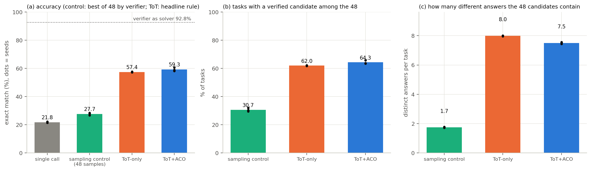
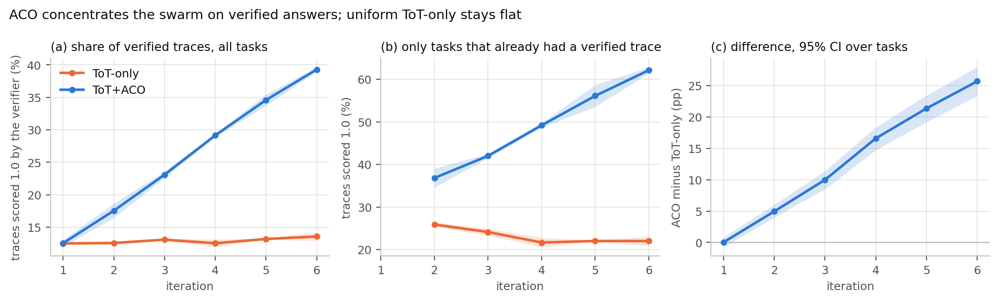
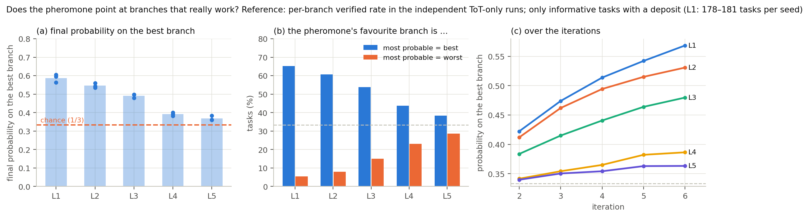
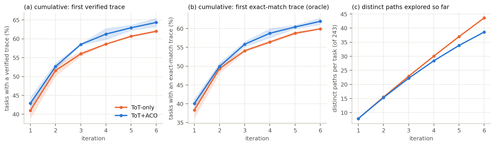
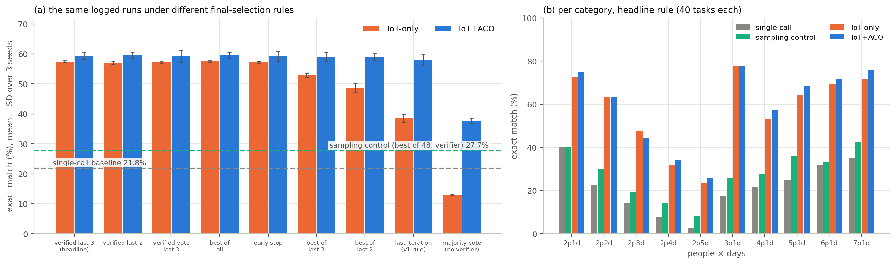

# Project Guide: Decentralized SLM Swarm Reasoning for Calendar Scheduling (v2)

This guide is for the team. It explains the whole project in one place: where it comes from, how the method works, why we made each important decision, what we ran, what came out, and how to explain it. It is not the README (that is for installing and running). Read it top to bottom once; afterwards use the table of contents.

All numbers below come from the logged runs in `results/` (400 test tasks, 3 seeds).

**Contents**
1. [The project in one page](#1-the-project-in-one-page)
2. [Where we started: benchmark, metric, leaderboard, model, data](#2-where-we-started)
3. [How the method works](#3-how-the-method-works)
4. [The five configurations we compare](#4-the-five-configurations-we-compare)
5. [What changed from v1 to v2, and why](#5-what-changed-from-v1-to-v2-and-why)
6. [Key decisions and their reasons](#6-key-decisions-and-their-reasons)
7. [How to run it](#7-how-to-run-it)
8. [The runs and the logs](#8-the-runs-and-the-logs)
9. [Results](#9-results)
10. [Analyses, explained simply](#10-analyses-explained-simply)
11. [Limitations (say these before anyone asks)](#11-limitations)
12. [How to present it, and likely questions](#12-how-to-present-it-and-likely-questions)
13. [Glossary](#13-glossary)
14. [Where to find things](#14-where-to-find-things)

---

## 1. The project in one page

**Research question.** Can several *small* language models (SLMs), coordinated like an ant colony instead of by a central manager, solve constrained planning problems better than one SLM on its own? And does the ant-colony part (ACO, pheromones) actually influence the search?

**Task.** Calendar scheduling from Google DeepMind's NATURAL PLAN benchmark: given people's busy times, a meeting duration, work hours and some preferences, propose one meeting slot (`Here is the proposed time: Monday, 14:30 - 15:30`).

**Method in one sentence.** 8 agents (each one SLM call chain) walk a fixed 5-level Tree-of-Thought 6 times per task (48 walks); at each level they choose one of 3 reasoning strategies; a deterministic verifier scores every answer; with ACO, strategies that led to perfect answers get pheromone and are chosen more often; at the end one answer is selected by a fixed rule.

**Model.** `google/gemma-3-4b-it` (4B parameters), via OpenRouter, pinned to the provider DeepInfra, temperature 0.

**History.**
- **v1** (published paper): baseline 24.75%, ToT-only 39.5%, ToT+ACO 40.0% (one run each).
- **Professor's feedback on v1** (`suggestions-v1.md` in the project root), five requirements:
  - **Req. 1:** a complete, runnable repository (code, environment, configs, prompts, reproduction steps).
  - **Req. 2:** the original outputs and logs behind every reported number.
  - **Req. 3:** baseline, ToT-only and ToT+ACO with at least 3 seeds, mean ± SD.
  - **Req. 4:** concrete evidence that ACO actually influences the search (pheromones, branch probabilities, …).
  - **Req. 5:** a revised paper whose conclusions follow the evidence, saying so explicitly if ACO does not beat ToT-only.

  This is followed by a meeting where we demonstrate the system and answer technical questions.
- **v2** (this folder): fixed bugs, rebuilt the method on evidence, ran everything with 3 seeds and full logging.

**Headline results (v2, 400 test tasks, 3 seeds, exact match):**

| Configuration | Exact match (mean ± SD) |
|---|---|
| Single SLM call (baseline) | **21.75% ± 0.4** |
| Sampling control: 48 direct samples, verifier picks the best | 27.7% ± 0.9 |
| ToT-only (8 agents × 6 iterations, random branches) | **57.4% ± 0.3** |
| ToT+ACO (same, pheromone-guided branches) | **59.3% ± 1.3** |
| Verifier-as-solver (reference, no LLM) | 92.75% |

**The three messages to remember:**
1. **The Tree-of-Thought swarm is the big win:** 21.75% → 57–59%, and it is *not* just "many samples plus a verifier" (that only reaches 27.7%).
2. **ACO clearly changes how the swarm searches:** the share of perfect answers per iteration rises from 12.6% to 39.3% with ACO, while it stays flat at about 13% without it, and the pheromone moves onto the branches that really work.
3. **ACO adds only a small accuracy gain on the headline number** (+1.9 points, significant in 1 of 3 seeds), and we explain exactly why: with an exact verifier, the best answer is usually secured before the pheromone has learned anything.

---

## 2. Where we started

### 2.1 NATURAL PLAN

NATURAL PLAN (Zheng et al., 2024, Google DeepMind; paper in `documents/natural-planner-paper.pdf`, code and data in `natural-plan/`) is a planning benchmark in natural language with three tasks: Trip Planning (1,600 tasks), Meeting Planning (1,000) and **Calendar Scheduling (1,000)**. The models get all the information they need (tool outputs such as Google Calendar data) in the prompt, so no tool use is needed; it tests planning only.

**Calendar Scheduling** in detail:
- Schedule a meeting of **30 minutes or 1 hour** inside work hours (9:00–17:00).
- **Two families of tasks:**
  - 2 to 7 people on **one fixed day** (Monday);
  - **2 people** over **1 to 5 work days**.
- That gives **10 categories of 100 tasks**: `2p_1d`, `2p_2d`, `2p_3d`, `2p_4d`, `2p_5d`, `3p_1d`, `4p_1d`, `5p_1d`, `6p_1d`, `7p_1d` (p = people, d = days).
- Busy schedules were generated randomly (half of the people have a busy day, half a light day). Then two kinds of constraints were added: **earliest availability** ("would like to meet at their earliest availability") and **avoid a time frame** ("would rather not meet on Monday after 13:30"). The paper says these constraints were added "to make sure there is a single solution". **We found that this is not always true** (Section 2.3).
- Each task comes as a **5-shot prompt** (5 solved examples, then the task) and as a **0-shot prompt** (the task only).

**How hard is it for big models?** From the NATURAL PLAN paper (5-shot): GPT-3.5 19.9%, GPT-4 41.2%, GPT-4o 43.7%, Gemini 1.5 Flash 34.3%, **Gemini 1.5 Pro 48.9%**. All models are below 50%. Our 4B swarm at 57–59% on our curated subset is therefore a strong number, but the subsets differ, so do not present it as "beating GPT-4" without that caveat.

**A real example** (`calendar_scheduling_example_0`, a 3p_1d task):
> You need to schedule a meeting for Michelle, Steven and Jerry for one hour between the work hours of 9:00 to 17:00 on Monday.
> Michelle has meetings on Monday during 11:00 to 12:00;
> Steven has blocked their calendar on Monday during 9:00 to 9:30, 11:30 to 12:00, 13:30 to 14:00, 15:30 to 16:00;
> Jerry has blocked their calendar on Monday during 9:00 to 9:30, 10:00 to 11:00, 11:30 to 12:30, 13:00 to 14:30, 15:30 to 16:00, 16:30 to 17:00;
> Find a time that works for everyone's schedule and constraints.
>
> Gold answer: `Here is the proposed time: Monday, 14:30 - 15:30`

### 2.2 How it is evaluated

- **Metric: exact match ("solve rate").** The official script (`scripts/evaluate.py`, copied unchanged from `natural-plan/evaluate_calendar_scheduling.py`, Apache-2.0 header kept) extracts day, start time and end time from the answer and compares them with the gold answer. All three must match exactly. Anything else, including a *different but valid* slot, counts as wrong.
- We keep exact match as the **main metric** so our numbers stay comparable with NATURAL PLAN and with v1.
- Next to it we report the **valid-answer rate** (`verified`): the share of answers our verifier scores 1.0 (all constraints and preferences met). The gap between the two shows how many "misses" are valid answers that simply differ from the single gold answer.

### 2.3 A property of the benchmark we discovered: several correct answers

We checked every one of the 1,000 tasks with our verifier (the verifier audit, `scripts/audit_verifier.py`):
- **166 of 1,000 tasks have several equally good answers** (every constraint and preference met, and no "earliest" request that would pick one).
- In **66** of them the gold answer is not even the earliest of those answers (29 of them are in our test set).
- None of these 166 tasks asks for the earliest availability; whenever a task does ask for it, the answer is unique.

Consequence: **no system can reach 100% exact match**; a verifier that picks the earliest of the equally good answers tops out at 93.4% (all 1,000) or 92.75% (our test set). Wording for the paper: "*we observe* that…", because these counts are our measurement, not an official figure.

### 2.4 Our SLM leaderboard (model selection)

Before v1 we ran five open SLMs on the **full 1,000 calendar tasks** to choose a model (`documents/slm-leaderboard-v1.pdf`):

| Rank | Model | Params | Solve rate |
|---|---|---|---|
| 1 | gemma-2-9b-it | 9B | 25.5% |
| 2 | **gemma-3-4b-it** | **4B** | **22.9%** |
| 3 | mistral:7b | 7B | 17.9% |
| 4 | qwen2.5:7b | 7B | 12.5% |
| 5 | llama3:8b | 8B | 7.1% |

We chose **gemma-3-4b-it**: within 2.6 points of the best model at less than half its size, which fits the "small, lightweight agents" idea. We kept it in v2 so that results stay comparable with v1 and the leaderboard (no new model search).

### 2.5 The datasets

All built by `scripts/build_datasets.py` from `natural-plan/data/calendar_scheduling.json`, with SHA-256 hashes in `data/manifest.json`.

| File | Tasks | How it is built | Used for |
|---|---|---|---|
| `data/curated_400.json` | 400 | the **first 40 tasks of each of the 10 categories** (in source order) | **the test set**: all reported results. Checked to be identical to v1's set. |
| `data/dev_100.json` | 100 | the **next 10 tasks** of each category (tasks 41–50) | development only, never overlaps the test set |
| (path table) | 20 | 2 tasks per category from the dev set | the dev path-table analysis (Section 10.6), because 100 was over budget |
| `data/verifier_known_exceptions.json` | 66 | tasks where gold is not the earliest of several equally good answers | documentation and a test |

**Why 400 and not 1,000?** Cost. 40 per category keeps every category equally represented. **Why a separate dev set?** All tuning and analysis decisions were made on dev tasks only, so the test numbers are not tuned on the test set.

Fields per task: `num_people`, `num_days`, `duration`, `prompt_5shot` (what the LLM sees), `prompt_0shot` (what the verifier parses), `golden_plan` (gold answer). The leftover prediction fields of an old Qwen run that v1's file still contained were removed.

---

## 3. How the method works

### 3.1 The big picture

```
                         one task (e.g. calendar_scheduling_example_0)
                                         |
                     pheromone table reset: every branch tau = 1.0
                                         |
     +----------------- iteration t = 1 .. 6 ------------------------------------+
     |                                                                            |
     |   agent 1   agent 2   ...   agent 8        (run in parallel)               |
     |      |         |              |                                            |
     |   walk the 5-level tree: at each level pick 1 of 3 branches               |
     |   (ToT-only: uniformly at random; ToT+ACO: by pheromone probability)       |
     |      |                                                                     |
     |   6 LLM calls per walk (5 levels + 1 finalize) -> one answer               |
     |      |                                                                     |
     |   deterministic verifier scores each answer (0 .. 1.0)                     |
     |      |                                                                     |
     |   ToT+ACO only: evaporate pheromone, add deposits from answers scored 1.0  |
     +----------------------------------------------------------------------------+
                                         |
                 48 scored answers (8 agents x 6 iterations), all logged
                                         |
                 final selection rule (headline: verified_last3)
                                         |
                       "Here is the proposed time: Monday, 14:30 - 15:30"
```

Every task is solved independently. The pheromone is **local to one task**: it is reset at the start of every task, so nothing is learned across tasks.

### 3.2 The Tree-of-Thought (ToT)

Tree-of-Thought (Yao et al., 2023) breaks reasoning into steps and allows several alternative "thoughts" per step. Ours is a **fixed, hand-designed tree for calendar scheduling: 5 levels × 3 branches**, defined in `src/swarm_planner/tot/levels.py`.

| Level | Goal | Branch A | Branch B | Branch C |
|---|---|---|---|---|
| **L1** Parse the task | understand what must be scheduled | **Constraint-first**: extract duration, days, work hours, preferences first | **People-first**: list participants, then each one's constraints | **Preference-first**: special preferences first, then the rest |
| **L2** Organise calendars | turn text schedules into structure | **Participant-wise**: busy slots per person | **Day-wise**: all busy slots per day, no names | **Mixed**: by day, then by person |
| **L3** Generate availability | find possible free windows | **Free-slot computation**: free intervals per person, then intersect | **Candidate enumeration**: list all windows, remove bad ones | **Progressive elimination**: start with the whole day, remove busy times step by step |
| **L4** Apply preferences | choose among candidates | **Earliest-valid** (if earliest is requested) | **Preference-priority** | **Conservative**: keep a buffer from busy times |
| **L5** Final answer | produce a formatted answer | **Direct output** | **One-step self-check** | **Format check** |

- A **path** (or **trace**) is one choice per level, e.g. `constraint_first → day_wise → free_slot_computation → earliest_valid → one_step_self_check`. There are **3⁵ = 243 possible paths** per task.
- At every level the agent gets the original task plus all previous intermediate results, and is told to produce only the intermediate result for its current branch.
- After L5 a separate **finalize call** writes the answer in the required one-line format. So one walk = **6 LLM calls**.
- Because identical requests are cached (Section 3.8), agents that share a path prefix share calls. A task has at most 3 + 9 + 27 + 81 + 243 + 243 = **606 distinct requests**.

### 3.3 Agents and iterations

- **n = 8 agents per iteration, T = 6 iterations per task = 48 walks = 288 LLM calls per task.** For 400 tasks: 115,200 calls per run (about 56–63k distinct requests, the rest is shared).
- An **agent** is not a separate model or process with memory: it is one independent walk of the tree with the same SLM. Agents do not talk to each other. In ToT+ACO they coordinate only *indirectly*, through the shared pheromone table (this is called **stigmergy**, how real ants coordinate through pheromone trails).
- **Why iterations?** ACO needs rounds: agents walk, the results update the pheromone, the next round's agents read it. Without ACO the iterations are just more random samples.
- The same budget (8 × 6) as v1, kept for comparability.

### 3.4 The verifier (the quality signal)

The verifier (`src/swarm_planner/verifier/`) is ordinary deterministic code, **not an LLM**. It parses the 0-shot task text (people, busy times, days, work hours, duration, preferences) and judges a proposed slot in strict priority order:

1. **Hard constraints** (5 checks): allowed day; correct duration; inside work hours; nobody is busy; no "can not meet" rule violated.
2. **Soft preferences**: "would like to avoid…", "would rather not…", "do not want to…".
3. **Earliest availability** (only if the task asks for it): the slot must be the earliest among the slots that are best on the preferences.

**Score:**
- Hard-valid answer: `score = 0.5 + 0.5 × (share of soft preferences met, with "earliest" counted as one of them)`, so 0.5 to 1.0.
- Answer that fails a hard check: `score = 0.49 × (share of hard checks passed)`, so at most 0.392.
- The two ranges never overlap: any valid answer beats any invalid one.
- **"Verified" = score exactly 1.0** = valid, every preference met, and earliest if requested. This is the word used everywhere in our results.

The verifier also enumerates every valid slot in 30-minute steps. That makes it extremely strong: **used on its own as a solver** (answer the earliest top-scoring slot) it gets **92.75%** of the test set right. We report this as a reference row and say openly that our system is **verifier-guided generation** (Section 11).

**Quality checks (verifier audit):** gold scores 1.0 and is a top-scoring slot on **all 1,000 tasks**; zero parser warnings; every busy interval in the text is parsed. Two v1 bugs were fixed (Section 5).

**Where the verifier is used:**
- (a) scoring every answer;
- (b) deciding the pheromone deposit (ToT+ACO only);
- (c) the final selection rule (all swarm modes and the sampling control).

### 3.5 Ant Colony Optimization (ACO): pheromones

ACO (Dorigo, 1992; Dorigo et al., 1996) copies how ants find short paths: ants leave pheromone on paths that worked, pheromone evaporates over time, and later ants prefer paths with more pheromone. Our version follows Chari et al. (2025, "Pheromone-based learning of optimal reasoning paths"), adapted to calendar scheduling and SLMs.

**Pheromone table.** One number τ for each of the 15 branches (5 levels × 3). Start: τ = 1.0 everywhere, so every branch has probability 1/3.

**Choosing a branch** (at each level, for each agent):

```
p(branch j at level i) = (τ_ij + ε)^α / Σ_k (τ_ik + ε)^α        α = 1.0, ε = 0.001
```

So the probability is simply proportional to the pheromone. (v1 also multiplied in a hand-made "heuristic desirability" η; v2 dropped it, Section 5.)

**Updating after each iteration** (ToT+ACO only):

```
τ ← (1 − ρ) · τ + deposits        ρ = 0.1 (10% evaporation)
deposit: every answer the verifier scores 1.0 adds Q = 1 to each of the 5 branches on its path;
         every other answer adds nothing ("top-only" deposit)
```

**Worked example (level 1).** Start τ = (1.0, 1.0, 1.0), p = (0.33, 0.33, 0.33). In iteration 1, two of the 8 agents produce a verified answer, and both went through *constraint-first* at L1.
- After the update: τ = (0.9 + 2, 0.9, 0.9) = (2.9, 0.9, 0.9), so p ≈ (0.62, 0.19, 0.19).
- In iteration 2 about 62% of the agents start with constraint-first.
- If nobody is verified in an iteration, only evaporation applies. It shrinks all values by the same factor, so **the probabilities do not change**: the pheromone only moves when something succeeds.

**ToT-only** uses exactly the same tree and budget, but every branch is drawn uniformly at random and nothing is updated. It is the "ACO switched off" control.

**Why "top-only" deposit?** v1 let every answer deposit its score, including invalid ones (up to 0.39), so the pheromone mostly counted visits instead of success and did not learn (probability on the best L1 branch 0.292 → 0.295 in our simulation). With top-only it learns (→ 0.55–0.66). See Section 6.

### 3.6 Choosing the final answer (selection rules)

A task ends with 48 scored answers. A **selection rule** picks the one that is submitted. The rule only *chooses*; it does not change the search. Because the logs keep all 48 answers, every rule can be computed afterwards from the same runs, so we report several side by side.

Ordering used to compare traces ("best trace"):
1. verifier score;
2. hard-valid;
3. share of preferences met;
4. earlier slot;
5. path probability;
6. earlier iteration, then lower agent id.

| Rule | What it picks | Note |
|---|---|---|
| **`verified_last3` (HEADLINE)** | Among the answers of the **last 3 iterations** (4–6) that the verifier scores 1.0, the **earliest slot**. If there is none, the best answer of the whole run. | Fixed **before** the test runs. Equals "best of the last 3 iterations, restricted to verified answers". |
| `verified_last2` | same with the last 2 iterations | sensitivity check |
| `verified_vote_last3/2` | same candidates, but the **most frequent** answer wins (ties: earliest) | a true vote |
| `best_of_all` | the best answer of all 48 | the standard "best-so-far" in ACO |
| `best_of_last3/2` | the best answer of the last 3 / 2 iterations | |
| `last_iteration` | the best answer of iteration 6 only | **the v1 rule** |
| `majority_vote` | the most frequent answer of all 48; the verifier is **not** used | shows what ACO does without a verifier at selection time |
| `early_stop` | the best answer up to the first iteration that has a verified answer | what a search that stops at the first success would answer |

**The headline rule in three steps** (`verified_last3`):
1. **Window:** keep only the 24 answers of iterations 4, 5 and 6.
2. **Filter:** keep those the verifier scored exactly 1.0 (all constraints and preferences met, earliest if requested).
3. **Pick:** submit the **earliest slot** among them. Votes do not matter. Example: 3 answers say Monday 9:30 and 2 say Monday 14:30, so we submit 9:30. If the counts were 2 for 9:30 and 3 for 14:30, we would still submit 9:30; a true vote (`verified_vote_last3`) would pick 14:30.

**Fallback** (used when none of the 24 answers of iterations 4–6 is verified):
- **What it does:** submit the **best answer of all 48** (any iteration), using the ordering above: verifier score first, then preferences met, then earlier slot.
- **When it is used.** Iterations 4–6 hold no verified answer because either:
  - the task was **solved early** (verified answer only in iterations 1–3) and the late iterations missed it. This happens more often for ToT-only, whose late iterations are no better than its early ones; or
  - the task was **never solved** (no verified answer anywhere).
- **What it submits:**
  - solved early: the verified answer from iterations 1–3, because it is the best of the run;
  - never solved: the best partial answer. Example: iteration 2 produced a slot that meets all hard constraints and the avoid-the-afternoon preference but is not the earliest (score 0.75, the highest in the run), so we submit that one.
- **When it is not used:** if iterations 4–6 contain a verified answer, the main rule decides and the fallback is ignored.

**How this relates to `best_of_all`:**
- In both fallback cases the headline submits the best of all 48, which is exactly what `best_of_all` takes. So the two rules submit the same answer there.
- They also agree when the task has only one distinct verified answer.
- They differ only when a task has **several different verified answers**, the earliest one overall comes from iterations 1–3, and the window holds a later one. Then `best_of_all` submits the early one and the headline submits the later one.
- This is rare, in both modes: 2 of 400 tasks per seed for ToT-only and 0–1 for ToT+ACO. Hence 57.4 vs 57.5 (ToT-only) and 59.3 vs 59.5 (ToT+ACO).

**Why this headline?**
- It takes the answer from the **later, pheromone-guided iterations**, where ACO has had a chance to act; best-of-all would hide ACO by design (Section 10.4).
- It uses the verifier as a filter, so both modes stay far above the baseline, which plain majority vote does not (ToT-only falls to 13%).
- **Why the earliest slot among verified answers:** on tasks with several valid answers, the earliest one matches gold far more often (59% vs about 41% for an arbitrary pick).

The window (last 3) was fixed on the dev analysis before any test run, and the other rules are reported next to it.

### 3.7 Seeds and randomness

- **Seeds 0, 1, 2.** Every random draw (which branch an agent takes) uses its own random stream derived from (seed, task, iteration, agent, level) with `numpy.random.SeedSequence`, so seeds are independent and runs are exactly reproducible. (v1 used `seed + task index`, so seed 43 on task i equalled seed 42 on task i+1.)
- **Temperature 0.** The model's own output is (nearly) deterministic for a given prompt, so in the swarm the seeds vary the **branch choices**, not the model's wording. We found the provider is *not* perfectly deterministic at temperature 0 (3 different answers in 15 identical calls); the cache freezes the first answer, which makes runs repeatable.

### 3.8 Infrastructure (what makes it reproducible)

- **One LLM gateway** for every call: OpenRouter, model `google/gemma-3-4b-it`, pinned to **DeepInfra with no fallback** (an outage stops a run instead of silently switching hardware), temperature 0, top_p 1, max 400 tokens. Provider, tokens, cost and latency are recorded per call.
- **Response cache** (SQLite, `results/cache/llm_cache.sqlite`): every request and answer is stored once, keyed by a hash of model, parameters and messages. The benefits:
  - identical requests (agents sharing a path prefix, ToT-only and ToT+ACO walking the same path) get the **same answer**, which makes the two modes directly comparable;
  - an interrupted run resumes for free;
  - the whole study can be **replayed without API calls**.

  Stochastic runs (the sampling control, the baseline seeds) add a **nonce** so they make real separate calls.
- **Event log per run** (`events.jsonl.gz`): config, git commit, packages, and for every task and iteration the pheromone before and after, every agent's branch probabilities, path, answer and verifier result, plus one record per LLM call. This is what all analyses are computed from.
- **Hard cost cap per run** (`--max_cost_usd`): the run stops (resumably) once it has paid that much.

---

## 4. The five configurations we compare

| Configuration | What it does | LLM calls per task | Why it is there |
|---|---|---|---|
| **Single-SLM baseline** | One call with the 5-shot prompt, temperature 0, answer as is | 1 | Required by the professor. "What does the model do on its own?" Each seed is a real separate call (seed used as cache nonce). |
| **Sampling control** | The same single-call prompt **48 times** at temperature 0.7; the verifier picks the best answer | 48 | Same number of attempts and same verifier as the swarm, but **no tree**. Separates "the tree helps" from "many attempts plus a verifier help". |
| **ToT-only** | 8 agents × 6 iterations, random branches, no pheromone | 288 | Required. The tree without ACO. |
| **ToT+ACO** | 8 agents × 6 iterations, pheromone-guided branches, top-only deposit | 288 | Required. The full method. |
| **Verifier-as-solver** | No LLM: answer the verifier's own best slot | 0 | Reference row. Shows how much the verifier alone can do. |

All configurations run on the same 400 test tasks with seeds 0, 1, 2 (the verifier row is deterministic, one run). Their settings are in `configs/*.yaml`.

---

## 5. What changed from v1 to v2, and why

| # | v1 | v2 | Why |
|---|---|---|---|
| 1 | Repo did not run on a clean checkout (deleted module still imported, invalid JSON file) | Clean `src/` package, pinned dependencies, 163 tests | Professor's Req. 1 |
| 2 | Only the ToT+ACO output shipped; no logs for baseline or ToT-only | Every run ships predictions, full event log, summary, resolved config; plus the response cache | Req. 2 |
| 3 | One run per configuration | 3 seeds, mean ± SD, bootstrap CIs, paired McNemar tests | Req. 3 |
| 4 | Verifier bug: "Doris" became "Dor is", so her calendar was dropped (15 test tasks affected) | Fixed | Invalid answers were scored as valid and attracted pheromone |
| 5 | "Earliest" judged among *all* valid slots, ignoring preferences; gold scored < 1.0 on 35 tasks | Strict order: hard → preferences → earliest among the best; gold scores 1.0 on all 1,000 | Gold was not always ranked best. Verifier-as-solver 86.0% → 93.4% |
| 6 | Every answer deposited its score, including invalid ones (up to 0.39) | **Top-only**: only verified answers (score 1.0) deposit | The v1 pheromone mostly counted visits and did not learn |
| 7 | Heuristic desirability η (hand-made rules) multiplied into the branch probability | **Dropped** | Dev analysis: η gave no benefit and favoured the *worst* L1 branch in 7 of 10 informative tasks |
| 8 | Final answer = best of the **last iteration** only (40 of 48 answers thrown away) | Headline `verified_last3`, and every rule reported side by side | Most of the search was wasted; the selection rule changes accuracy by up to 20 points |
| 9 | Seeds overlapped across tasks (`seed + task index`) | Independent per-call random streams | Consecutive seeds were not independent replicates |
| 10 | Logs kept only the last iteration | Full per-iteration pheromone, probabilities, all traces, all calls | Req. 4 needs the evidence |
| 11 | — | Sampling control added | To prove the tree, not just sampling, is what helps |
| 12 | — | Full budget, **no early stopping** | With early stopping ACO could never act (Section 6) |

**Why did v2 accuracy jump from ~40% to ~57–59% while the tree, model and budget are the same?** Mostly the **selection rule** (v1 discarded 40 of 48 answers: ToT-only under the v1 rule is 38.6% in v2, almost exactly v1's 39.5%) and the **fixed verifier** (better scoring of answers). The model and the tree are unchanged.

**Why is the v2 baseline (21.75%) lower than v1's (24.75%)?** Different provider and run date, and temperature 0 is not exactly deterministic; it is a single call, so it inherits that noise. We state it openly.

---

## 6. Key decisions and their reasons

| Decision | Choice | Reason |
|---|---|---|
| Model | Keep gemma-3-4b-it | Comparability with v1 and the leaderboard; no budget for a new model search |
| Temperature | 0 | As in v1; lets the cache reuse answers; seeds then control the search, not the wording |
| Quality signal | The fixed deterministic verifier | No time for a learned reward model; a feasibility-only checker would likely look like a regression. Its strength is a limitation we state (Section 11). |
| Tree | Keep the 5-level tree | Analysed, not redesigned; changing it would break comparability |
| Heuristic η | Removed | No benefit on the dev analysis, pointed the wrong way at L1 |
| Deposit | Top-only | The only rule under which the pheromone clearly learned (dev simulation: best L1 branch 0.333 → 0.66) |
| Early stopping | Not used in the runs (computed offline) | Pheromone only changes after a verified answer; if the search stops at the first verified answer, ACO never acts |
| Budget | 8 × 6, full | Same as v1; under best-of-all the split between agents and iterations does not matter |
| Headline rule | `verified_last3`, fixed before the test runs | Takes the answer from the pheromone-guided iterations, keeps both modes far above baseline; all others reported too (Section 3.6) |
| Dev analysis size | 20 tasks (not 100) | Budget: the full table would have cost about $9 |
| Code freeze | Tagged `experiments-freeze` before the first test run | So every number is traceable to fixed code |
| Common random numbers re-run | Not done | Would remove the noise in the ToT vs ACO comparison (Section 10.4) but changes frozen code; we report the noise instead |
| Total budget | About $30–35 accepted | Actual spend: about **$32.1** |

---

## 7. How to run it

All commands from `swarm-multi-agent-planner/swarm-multi-agent-planner-v2/`, PowerShell shown (bash twin: `scripts/run_all.sh`).

**Setup (once):**
```powershell
uv venv .venv --python 3.12
uv pip install --python .venv\Scripts\python.exe -e ".[dev,analysis]"
copy .env.example .env            # then put your OPENROUTER_API_KEY in .env
.venv\Scripts\python.exe -m pytest -q        # expect: 163 passed
```

**The settings live in `configs/`.** Every run script takes `--config configs/<name>.yaml`; any flag on the command line overrides the file.

**Reproduce everything (makes paid calls unless the cache already holds them):**
```powershell
.\scripts\run_experiments.ps1 -Step all -DryRun        # only print the commands
.\scripts\run_experiments.ps1 -Step baseline           # or: tot_only, tot_aco, sampling, verifier, evaluate, smoke
.\scripts\run_experiments.ps1 -Step tot_aco -Seeds 0   # one seed
```

**One run by hand:**
```powershell
.venv\Scripts\python.exe scripts\run_experiment.py --config configs\tot_aco.yaml --seed 0
.venv\Scripts\python.exe scripts\run_baseline.py --config configs\baseline.yaml --seed 0
.venv\Scripts\python.exe scripts\run_sampling_control.py --config configs\sampling_control.yaml --seed 0
.venv\Scripts\python.exe scripts\run_verifier_solver.py --config configs\verifier_solver.yaml
```

**Replay a run at zero cost (needs the cache file, see below):**
```powershell
.venv\Scripts\python.exe scripts\run_experiment.py --config configs\tot_aco.yaml --seed 0 --max_cost_usd 0 --run_dir results\replay\tot_aco\seed_0
```
`--max_cost_usd 0` guarantees no spending: a cache miss stops the run instead of paying. A replay of ToT-only and ToT+ACO seed 0 reproduced the stored predictions exactly (115,200 cache hits, 0 paid calls).

**The cache is not in git** (about 430 MB). It will be published with the release archive; until then ask Imon for a copy and put it at `results/cache/llm_cache.sqlite`.

**Evaluate, tables, figures (free, offline):**
```powershell
.\scripts\run_experiments.ps1 -Step evaluate                  # derive every rule, aggregate -> results\aggregate\main\report.txt
.venv\Scripts\python.exe scripts\make_tables.py               # -> results\aggregate\analysis\tables\
.venv\Scripts\python.exe scripts\make_figures.py              # -> results\aggregate\analysis\figures\
.venv\Scripts\python.exe scripts\investigate_aco_effect.py    # the best-of-all investigation
.venv\Scripts\python.exe scripts\evaluate.py --data_path results\runs\tot_aco\seed_0\predictions.json   # official evaluator, one run
```

**Rules:** run one step at a time (one process on the cache file); never delete the cache; do not start paid runs without agreeing on the budget.

---

## 8. The runs and the logs

| Run | Date (2026) | Code | Calls | Cost |
|---|---|---|---|---|
| Baseline, seeds 0–2 | 11-07 | `4a88377` (tag `experiments-freeze`) | 3 × 400 | $0.14 |
| ToT-only, seeds 0–2 | 11-08 to 11-11 | `786b3b9` | 3 × 115,200 | together with ToT+ACO: |
| ToT+ACO, seeds 0–2 | 11-11 | `786b3b9` | 3 × 115,200 | **$25.38** (176,394 distinct requests) |
| Sampling control, seeds 0–2 | 11-15 | `ec5e5d4` | 3 × 19,200 | $6.61 |
| Verifier-as-solver | before | — | 0 | $0 |
| **Total** | | | | **about $32.1** |

- The run code is identical across these commits (only analysis code and docs changed in between). The sampling control's log says `git_dirty: true` (uncommitted analysis files at the time); its run code is byte-identical to the tag.
- Without the cache, one ToT run would cost about $16; ToT+ACO needs fewer distinct requests than ToT-only (about 56k vs 63k) because the pheromone makes agents revisit the same paths.

**What each run folder contains** (`results/runs/<config>/seed_<s>/`):

| File | Content |
|---|---|
| `predictions.json` | the dataset with our answer per task (headline rule), readable by the official evaluator |
| `events.jsonl.gz` | the full event log (Section 3.8) |
| `summary.json` | totals: tasks, calls, cache hits, cost |
| `config.resolved.json` | every setting the run actually used, git commit, dataset hash |
| `derived/` | one prediction file **per selection rule**, `per_task.csv`, `selection_report.json` |

Aggregates: `results/aggregate/main/` (`report.txt`, `table_main.csv`, `per_category.csv`, `paired_tests.csv`) and `results/aggregate/analysis/` (tables and figures of Section 10).

---

## 9. Results

### 9.1 Main table (exact match, 400 tasks, mean over seeds 0/1/2)

| Configuration | Rule | Mean | SD | 95% CI (over tasks) | Valid-answer rate | Seeds 0 / 1 / 2 |
|---|---|---|---|---|---|---|
| Baseline | single call | **21.75%** | 0.43 | 17.8–25.7 | 24.3% | 21.50 / 21.50 / 22.25 |
| Sampling control | best of 48 by verifier | 27.67% | 0.88 | 23.3–31.9 | 30.7% | 26.75 / 28.50 / 27.75 |
| ToT-only | `verified_last3` | **57.42%** | 0.29 | 52.9–61.9 | 62.0% | 57.75 / 57.25 / 57.25 |
| ToT+ACO | `verified_last3` | **59.33%** | 1.28 | 54.9–63.8 | 64.3% | 60.75 / 58.25 / 59.00 |
| Verifier-as-solver | best slot | 92.75% | — | 90.3–95.3 | 100% | 92.75 |

Reading it:
- **Both swarm modes beat the baseline by 36–38 points** (paired McNemar test p < 0.0001 in every seed). The acceptance criterion we fixed in advance (both modes above the baseline under the headline rule) is met.
- **ToT+ACO vs ToT-only: +1.9 points**, 95% CI [+0.3, +3.6]; per seed +3.0, +1.0, +1.75, significant only in seed 0 (p = 0.043). Small and not consistent across seeds; see Section 10.4 for why.
- About 4–5 points separate the valid-answer rate from exact match in the swarm modes: these are mostly valid answers on tasks with several correct slots, where we picked a different one than gold (Section 2.3).

### 9.2 The same runs under every selection rule

| Rule | ToT-only | ToT+ACO | ACO − ToT-only (pooled, 95% CI) |
|---|---|---|---|
| **`verified_last3` (headline)** | 57.4 | 59.3 | **+1.9** [+0.3, +3.6] |
| `verified_last2` | 57.1 | 59.5 | +2.4 [+0.8, +4.1] |
| `verified_vote_last3` (true vote) | 57.2 | 59.3 | +2.1 [+0.4, +3.8] |
| `best_of_all` | 57.5 | 59.5 | +2.0 [+0.4, +3.7] (sampling noise, Section 10.4) |
| `early_stop` | 57.2 | 59.2 | +2.0 [+0.4, +3.7] |
| `best_of_last3` | 52.8 | 59.1 | +6.3 [+4.3, +8.3] |
| `best_of_last2` | 48.7 | 59.0 | +10.3 [+8.1, +12.7] |
| `last_iteration` (v1 rule) | 38.6 | 58.0 | **+19.4** [+16.4, +22.4] |
| `majority_vote` (no verifier) | 13.0 | 37.7 | **+24.7** [+21.3, +28.0] |

**How to read this table (important for the presentation):**
- **ToT+ACO is almost flat (58–60%) under every verifier-based rule; ToT-only collapses as the window shrinks** (57 → 39%). The reason: ACO concentrates its later iterations on verified answers, so *any* late window contains a good one. ToT-only's late iterations are just as random as its first ones, so a small window often contains no verified answer.
- The large gaps (+10, +19, +25) are real effects of ACO on *where the good answers are*, but they also reflect that those rules handicap ToT-only. Do not present them as "ACO is 19 points better"; present them as "ACO makes the late iterations reliable".
- **Majority vote** needs no verifier at selection time: ACO triples it (13% → 38%). This shows the colony really converges on answers, not just that the verifier filters them.
- The frequency vote and the earliest-slot rule agree within 0.25 points, so the tie-breaking choice does not drive the result.
- ToT-only under the v1 rule (38.6%) reproduces v1's ToT-only (39.5%) closely, which validates that v2 is the same system.

### 9.3 Swarm vs sampling control (paired)

| Comparison | Pooled difference | Per seed | p (each seed) |
|---|---|---|---|
| ToT-only (best-of-all) − control | **+29.8** [+24.8, +34.8] | +31.3, +28.8, +29.5 | < 0.0001 |
| ToT+ACO (best-of-all) − control | **+31.8** [+26.8, +36.8] | +34.0, +30.0, +31.5 | < 0.0001 |
| Same with the headline rule | +29.8 / +31.7 | | < 0.0001 |

The control picks the best of its 48 samples, which corresponds to best-of-all, so that is the fairest comparison; the headline gives the same picture.

### 9.4 Per category (exact match, mean over seeds)

| Category | Baseline | Sampling control | ToT-only | ToT+ACO | Verifier-as-solver |
|---|---|---|---|---|---|
| 2p_1d | 40.0 | 40.0 | 72.5 | 75.0 | 80.0 |
| 2p_2d | 22.5 | 30.0 | 63.3 | 63.3 | 90.0 |
| 2p_3d | 14.2 | 19.2 | 47.5 | 44.2 | 92.5 |
| 2p_4d | 7.5 | 14.2 | 31.7 | 34.2 | 87.5 |
| 2p_5d | 2.5 | 8.3 | 23.3 | 25.8 | 97.5 |
| 3p_1d | 17.5 | 25.8 | 77.5 | 77.5 | 92.5 |
| 4p_1d | 21.7 | 27.5 | 53.3 | 57.5 | 100.0 |
| 5p_1d | 25.0 | 35.8 | 64.2 | 68.3 | 92.5 |
| 6p_1d | 31.7 | 33.3 | 69.2 | 71.7 | 100.0 |
| 7p_1d | 35.0 | 42.5 | 71.7 | 75.8 | 95.0 |

- The swarm beats the baseline in **every** category, often doubling or tripling it.
- The hardest tasks for the model are **2 people over many days** (2p_4d, 2p_5d): long week-long calendars and many candidate slots. The verifier finds them easy (it just enumerates), the 4B model does not.
- 2p_1d is where the verifier is weakest (80%): many tasks with several valid slots (Section 2.3).
- ACO is ahead in 7 of 10 categories, equal in 2, behind in 1 (2p_3d): consistent with a small, uneven effect.

### 9.5 Cost

| | Calls per run | Distinct requests | Cost per run (cold cache) |
|---|---|---|---|
| Baseline | 400 | 400 | $0.046 |
| Sampling control | 19,200 | 19,200 | $2.20 |
| ToT-only | 115,200 | ~63.3k | ~$9.0 |
| ToT+ACO | 115,200 | ~55.8k | ~$8.0 |

About 305 M input and 8 M output tokens per ToT run (the 5-shot prompt is long and is resent at every level). Average paid call about 1 second at our concurrency.

---

## 10. Analyses, explained simply

Figures are in `results/aggregate/analysis/figures/` (PNG and PDF), tables in `results/aggregate/analysis/tables/`.

### 10.1 Is it the tree, or just "many attempts plus a verifier"? (sampling control)



- The control gets the same 48 attempts and the same verifier, but asks the same plain prompt 48 times at temperature 0.7.
- It reaches only **27.7%**: sampling plus the verifier explains about 6 of the 36 points we gain over the single call; the tree explains the other ~30.
- **Why the control is weak: it does not explore.** A single direct sample is verified *more* often than a single ToT walk (24% vs 13%), but the 48 samples of one task contain only **1.7 different answers on average**, and in **52% of the tasks all 48 samples are the same answer**. ToT-only produces **8.0** different answers per task (ToT+ACO 7.5). When the model is wrong, asking it again the same way gives the same wrong answer; the tree forces different intermediate reasoning and therefore different answers.
- Result: a verified answer exists among the 48 candidates in 31% of tasks for the control, against 62% / 64% for ToT-only / ToT+ACO.
- **Caveat:** we tested temperature 0.7 only. A higher temperature or a "be diverse" prompt might help the control; we say "the sampling control as specified", not "any sampling".

### 10.2 Does ACO change the search? (the main evidence for the professor's Req. 4)



Share of the 3,200 walks per iteration (400 tasks × 8 agents) whose answer the verifier scores 1.0, mean over seeds:

| Iteration | 1 | 2 | 3 | 4 | 5 | 6 |
|---|---|---|---|---|---|---|
| ToT-only | 12.5% | 12.6% | 13.1% | 12.5% | 13.2% | 13.6% |
| **ToT+ACO** | 12.6% | 17.6% | 23.1% | 29.1% | 34.6% | **39.3%** |
| Difference (95% CI) | +0.0 [−0.7, +0.8] | +5.0 | +10.0 | +16.6 | +21.4 | **+25.7 [+23.4, +28.0]** |

- **Iteration 1 is identical** (as it must be: no pheromone yet). From then on ACO pulls the swarm towards verified answers every round; ToT-only stays flat because it never learns.
- Among tasks that already had a success, by iteration 6: **62%** of ACO's walks are verified against **22%** for ToT-only.
- Same picture for the average score of a walk (ACO 0.476 → 0.637, ToT-only flat at about 0.48) and for exact-match walks (ACO 11% → 36%, ToT-only flat at 11–12%) (`scores_per_iteration.png`).

### 10.3 Does the pheromone point to the branches that really work? (the key figure)



**How we checked it.** For each task, level and branch we measured how often that branch leads to a verified answer *in the ToT-only runs*. Those runs pick branches at random, so they give an unbiased "true quality" of every branch, independent of ACO. Then we asked: did ACO's pheromone end up on the truly best branch? (Tasks where the branches really differ, at least 5 points between best and worst, and ACO deposited at least once.)

| Level | Final ACO probability on the truly best branch (chance = 0.333) | ACO's favourite branch is the best / the worst one (chance 33% each) |
|---|---|---|
| L1 | **0.588** | **65%** / 5% |
| L2 | 0.546 | 61% / 8% |
| L3 | 0.492 | 54% / 15% |
| L4 | 0.392 | 44% / 23% |
| L5 | 0.369 | 38% / 29% |

- **ACO learns where the choice matters** (L1, L2) and stays close to uniform where it does not (L4, L5).
- This is exactly the ranking our independent dev analysis found (Section 10.6: only L1, and weakly L2, change correctness).
- So the pheromone is not just reinforcing whatever came first; it moves onto genuinely better strategies.

**Entropy** (`pheromone_heatmap_and_entropy.png`) measures how spread out the probabilities are: 1.0 means uniform, lower means concentrated. After the last update it is 0.53 (L1), 0.54 (L2), 0.61 (L3), 0.75 (L4), 0.78 (L5).

The heatmap of the probability *averaged over tasks* stays near 0.33. That is because the best branch differs from task to task, so the concentration only shows per task (entropy, table above).

### 10.4 Why the +2 points under best-of-all are not an ACO effect

This is the subtle point to understand well.

**The argument in five steps:**
1. **Nothing is deposited before a task's first verified answer**, because of the top-only deposit. Until then the ACO pheromone is exactly uniform; we checked 3,089 such iterations.
2. **Under best-of-all, the task's result is decided by its first verified answer.** Everything after that cannot change whether a verified answer exists. So under best-of-all, ToT+ACO and ToT-only are *the same search process* up to the moment that decides the result.
3. **So why +2 points?** The two modes draw their random branches in a technically different way (`rng.integers` vs `rng.random` in `tot/graph.py`). They never walk the same paths: identical iteration-1 paths in 0 of 400 tasks. They are two independent samples of the same process.
4. **The evidence:** the gap is already +1.9 points **after iteration 1, before any pheromone exists**, and it does not grow (+1.9, +1.1, +2.5, +2.7, +2.3, +2.3 after iterations 1–6). If ACO caused it, it would grow once the pheromone acts.
5. **Conclusion:** under best-of-all (and early stopping) the two modes are the same search by construction, and the +2 points are sampling noise. We report it as such.

This is the honest discussion the professor asked for ("if ACO does not consistently improve upon ToT-only, acknowledge and discuss it").

**The general lesson.** With an exact verifier as the reward, the best answer is often found *before* the colony has learned anything. ACO's value then shows in *how reliably* the swarm returns to good answers (Sections 10.2, 9.2), not in whether a good answer is ever found.

A noise-free comparison would use "common random numbers" (both modes using the same random draws until ACO's first deposit). We decided not to re-run (2026-11-15); it would tie under best-of-all by construction anyway.

### 10.5 First success and exploration



- **Share of tasks with at least one verified answer so far:**

  | After iteration | 1 | 2 | 3 | 4 | 5 | 6 |
  |---|---|---|---|---|---|---|
  | ToT-only | 41.0% | 51.6% | 56.0% | 58.6% | 60.7% | 62.0% |
  | ToT+ACO | 42.9% | 52.7% | 58.5% | 61.3% | 62.9% | 64.3% |

  Most successes come early: 41% of tasks are solved in iteration 1, and the curve flattens after that. About 36–38% of tasks never get a verified answer in 48 walks; that is the model's limit, not the search's.
- **Distinct paths explored per task** (of 243): ToT-only 43.6, ToT+ACO 38.6. ACO explores a little less, because it exploits what worked.
- **Oracle pass@48** (is *any* of the 48 answers exactly gold?): about 60% for ToT-only and 62% for ToT+ACO. Our selection rule gets within about 3 points of this ceiling.

### 10.6 What the dev path table taught us (20 dev tasks)

We ran **all 243 paths of 20 dev tasks** (4,860 paths, 12,120 calls, $1.59). That gives the exact quality of every possible path, so we could simulate any ToT/ACO setting offline for free. The simulator was checked against the real solver and matched it within about 2 points. Findings (wide error bars: 20 tasks):
- **Generation is the bottleneck.** 10 of 20 tasks have **no correct path at all** among the 243. 7 of them never produce even a valid answer: 6–7 people, or 2 people over 4–5 days. The 4B model often does not really compute the free slots: 19% of level-3 outputs already "announce" a final slot, and the slot stated at L3 equals gold in only 9% of paths.
- **Only level 1 matters clearly:** constraint-first +6.6 points, preference-first −4.5. Level 2 matters weakly, and levels 3–5 are indistinguishable from chance. Yet the finalize call is not redundant: it changes the slot in 23% of paths.
- **The heuristic η was useless or harmful.** Agents guided by η were 12.9% accurate against 13.1% for uniform agents, and at L1 η favoured the worst branch in 7 of 10 tasks, so we dropped it.
- **The selection rule matters most.** Best-of-all instead of last-iteration gives +9.8 points for ToT-only at no cost. The v1 ACO "gain" disappears under best-of-all.
- **The v1 deposit did not learn** (best L1 branch probability 0.292 → 0.295); top-only does (→ 0.55–0.66).
- **Early stopping** at the first verified answer gives the same accuracy with 62% of the calls. We did not use it because it stops ACO from acting (Section 6).
- **Budget curve (best-of-all):** 38.5% with 8 walks, 45.0% with 16, 46.9% with 24, 48.9% with 48 (ceiling 50%). The n × T split does not matter for best-of-all.
- **A verifier "look-ahead"** (judging the slot stated in intermediate steps to prune paths) works as a signal but gains under 1 point and wrongly prunes 13–22% of the correct paths, so it was not adopted.

### 10.7 Accuracy by rule and category



This one figure summarises Sections 9.2 and 9.4, with the sampling control included.

---

## 11. Limitations

Say these openly; they are part of the scientific story, not weaknesses to hide.

1. **The verifier is effectively a solver.** It enumerates every valid slot and alone gets 92.75%. Our system is therefore *verifier-guided generation*: the SLMs propose, the verifier judges. This also makes it a weak test of ACO's credit assignment, because the reward is almost perfect. We report the verifier-as-solver row and name a learned reward model or a feasibility-only checker as future work.
2. **Exact match undercounts.** 166 of 1,000 tasks have several equally good answers (Section 2.3), although NATURAL PLAN states that its constraints make the solution unique. We report the valid-answer rate next to exact match.
3. **ACO's accuracy gain is small and not consistent** (+1.9, significant in 1 of 3 seeds). Under best-of-all the difference is noise by construction (Section 10.4). ACO's demonstrated effect is on the search (Section 10.2), not on the headline accuracy.
4. **The two modes draw independent random paths**, so the ToT vs ACO comparison carries sampling noise; we did not re-run with common random numbers.
5. **One model, one provider, temperature 0, one frozen realisation.** The cache freezes one answer per request, and the provider is not perfectly deterministic at temperature 0. Seeds vary branch choices, not model noise.
6. **The model is the limit.** About 36% of tasks never get a verified answer from the 4B model in 48 walks.
7. **The dev analysis rests on 20 tasks** (10 solvable). The design decisions are well motivated but the dev intervals are wide; the test set confirmed the main predictions.
8. **The sampling control used temperature 0.7 only.**
9. **Curated subset:** 400 of the 1,000 tasks (first 40 per category), not the full benchmark.
10. **The baseline is 3 points below v1's** (21.75% vs 24.75%), due to the provider, the date and temperature-0 noise.
11. **The headline rule was chosen with ACO in mind.** It was fixed before the test runs, on dev evidence, and every alternative is reported.

---

## 12. How to present it, and likely questions

**A suggested story (about 10 slides):**
1. Problem: big LLMs plan poorly (NATURAL PLAN: GPT-4 41%), and centralised agents are expensive. Can a swarm of small models do better?
2. Task and benchmark: calendar scheduling, an example, exact match.
3. Method: the tree (5 × 3), agents and iterations, the verifier, pheromones (formula plus the worked example).
4. What we fixed after v1, and why (Section 5, the short version).
5. Main table: baseline 21.75% → swarm 57–59%.
6. Is it just sampling? No: the control reaches 27.7%, because it has only 1.7 distinct answers per task.
7. Does ACO act? Verified share per iteration, 12.6% → 39.3% vs flat.
8. Does it learn the right thing? Pheromone vs true branch quality: L1 65% best vs 5% worst.
9. Honest part: small headline gain, why best-of-all hides ACO (iteration-1 gap), and the selection-rule table.
10. Limitations and future work: verifier as solver, several correct answers per task, other reward signals, larger models or trees.

**Questions we should be ready for:**

- **"Why not just output the verifier's answer?"**
  - Because the verifier is a task-specific solver, and the research question is about LLM agents.
  - We report it (92.75%) as the upper reference and frame the system as verifier-guided generation.
  - The majority-vote row shows what the swarm does without the verifier at selection time.
- **"Did you choose the selection rule to make ACO look good?"**
  - It was fixed before the test runs, on dev evidence.
  - Every alternative is in the table, and under best-of-all we explicitly say ACO adds nothing.
- **"Is ACO better than ToT-only?"**
  - On the headline number only slightly and not consistently (+1.9, 1 of 3 seeds significant).
  - It clearly changes the search: verified share +25.7 points by iteration 6, the pheromone concentrates on the truly best branches, and late-iteration answers are reliable.
  - We claim "ACO influences the search", not "ACO beats ToT".
- **"Why is ToT+ACO better under best-of-all if you say it can't be?"** Independent random draws: the gap exists after iteration 1, before any pheromone, and does not grow (Section 10.4).
- **"Isn't the improvement just from sampling 48 times?"** No. The equal-budget sampling control reaches 27.7%; the tree's diverse reasoning is what helps (8 vs 1.7 distinct answers).
- **"Why is v2 so much better than v1 with the same model?"** Mainly the selection rule (v1 discarded 40 of 48 answers; under the v1 rule ToT-only is still 38.6%) and the fixed verifier.
- **"How do we know the results come from this code?"**
  - The code was tagged before the runs, and every log records the git commit, the packages, the dataset hash and every LLM call.
  - The cache replays the runs at $0 with identical predictions.
- **"Why temperature 0?"** As in v1. It makes the search, not the model's randomness, the varying part, and it allows caching; the sampling control covers the stochastic side.
- **"Why 8 agents × 6 iterations?"** Same as v1 for comparability. The dev analysis shows that under best-of-all the split does not matter and that more budget gives diminishing returns (48.9% with 48 walks vs 46.9% with 24).
- **"Why do some categories stay low?"** 2 people over 4–5 days: long calendars and many candidate slots, and the 4B model's slot arithmetic fails. The dev path table shows many of these tasks have no correct path at all.
- **"Is it decentralised?"**
  - Yes in the ACO sense: no manager agent, and agents coordinate only through the shared pheromone (stigmergy).
  - But one shared pheromone table per task exists, and the verifier is central.

---

## 13. Glossary

| Term | Meaning |
|---|---|
| SLM | Small language model (here 4B parameters) |
| ToT | Tree-of-Thought: reasoning split into levels with alternative branches |
| Level / branch | One reasoning step / one of its 3 alternative strategies |
| Path / trace / walk | One agent's sequence of 5 branch choices, ending in one answer (6 LLM calls) |
| Agent | One independent walk of the tree in an iteration (8 per iteration) |
| Iteration | One round of 8 walks, followed by the pheromone update |
| Pheromone τ | One number per branch; higher means more likely to be chosen (ACO only) |
| Evaporation ρ | 10% of the pheromone fades after each iteration |
| Deposit | Pheromone added to the branches of a path whose answer was verified (top-only) |
| η (eta) | v1's hand-made heuristic preference per branch; removed in v2 |
| Verifier | Deterministic code that checks an answer against the task; gives a score 0–1 |
| Verified | Verifier score exactly 1.0: valid, all preferences met, earliest if requested |
| Hard-valid | Passes all 5 hard checks (may still miss a preference) |
| Exact match | The official metric: day, start and end equal the gold answer |
| Valid-answer rate | Share of submitted answers that are verified |
| Selection rule | How the one submitted answer is chosen from the 48 |
| `verified_last3` | Headline rule: earliest verified answer of iterations 4–6, otherwise the best of the run |
| Best-of-all | The best answer of all 48 |
| Sampling control | 48 plain samples at temperature 0.7, best one by the verifier |
| Verifier-as-solver | The verifier's own best slot, no LLM |
| Cache | Stored LLM answers; makes runs repeatable and replayable for free |
| Nonce | Extra key that forces a separate (non-cached) call, used for stochastic samples |
| Path table | All 243 paths of a dev task, run once, used for offline simulation |
| McNemar test | Paired test on the tasks where exactly one of two systems is right |
| Bootstrap CI | Confidence interval obtained by resampling the 400 tasks |

---

## 14. Where to find things

| What | Where |
|---|---|
| Professor's feedback | `../../suggestions-v1.md` (project root) |
| v1 paper, NATURAL PLAN paper, leaderboard, handbook | `../../documents/` |
| NATURAL PLAN data and official evaluator | `../../natural-plan/` |
| v1 code | `../swarm-multi-agent-planner-v1/` |
| Run drivers | `scripts/run_experiments.ps1`, `scripts/run_all.sh` |
| Run settings | `configs/` |
| Tree definition / prompts | `src/swarm_planner/tot/levels.py` / `tot/prompts.py` |
| Branch probability / pheromone update | `src/swarm_planner/aco/selection.py` / `aco/pheromone.py` |
| Verifier | `src/swarm_planner/verifier/parser.py`, `scorer.py` |
| Selection rules | `src/swarm_planner/selection_rules.py` |
| Solver loop (agents, iterations) | `src/swarm_planner/solver.py`, `tot/graph.py` |
| Baseline, sampling control, verifier-as-solver | `src/swarm_planner/baseline.py` |
| Run outputs | `results/runs/<config>/seed_<s>/` |
| Main results report | `results/aggregate/main/report.txt` |
| Analysis tables and figures | `results/aggregate/analysis/` |
| Best-of-all investigation | `results/aggregate/analysis/best_of_all_investigation.txt` |
| Dev path table and its analyses | `results/path_table/dev_20/` |
| Verifier audit on all 1,000 tasks | `results/verifier_audit/` |
